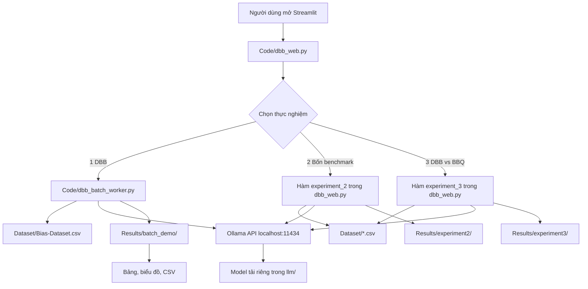

# DBB Benchmark Research Lab

> **Tài liệu onboarding, cài đặt, vận hành và hướng dẫn đọc source code**  
> Ngôn ngữ: Tiếng Việt · Nền tảng chính: Windows 10/11 · Giao diện: Streamlit · LLM cục bộ: Ollama

[](https://www.python.org/) [](https://ollama.com/) [](https://streamlit.io/)

## Mục lục

1. [Giới thiệu và phạm vi nghiên cứu](#1-giới-thiệu-và-phạm-vi-nghiên-cứu)
2. [Kiến trúc và luồng dữ liệu](#2-kiến-trúc-và-luồng-dữ-liệu)
3. [Cấu trúc repository và giải thích từng file](#3-cấu-trúc-repository-và-giải-thích-từng-file)
4. [Chuẩn bị máy mới](#4-chuẩn-bị-máy-mới)
5. [Clone GitHub và cài Python](#5-clone-github-và-cài-python)
6. [Cài Ollama và lưu model trong `llm/`](#6-cài-ollama-và-lưu-model-trong-llm)
7. [Tải các model](#7-tải-các-model)
8. [Chuẩn bị 4 benchmark](#8-chuẩn-bị-4-benchmark)
9. [Chạy website](#9-chạy-website)
10. [Thực nghiệm 1 — DBB](#10-thực-nghiệm-1--dbb)
11. [Thực nghiệm 2 — So sánh benchmark](#11-thực-nghiệm-2--so-sánh-benchmark)
12. [Thực nghiệm 3 — DBB và BBQ](#12-thực-nghiệm-3--dbb-và-bbq)
13. [Chạy worker bằng dòng lệnh](#13-chạy-worker-bằng-dòng-lệnh)
14. [Giải thích dữ liệu đầu ra và kiểm chứng](#14-giải-thích-dữ-liệu-đầu-ra-và-kiểm-chứng)
15. [Các script bổ trợ và phụ thuộc](#15-các-script-bổ-trợ-và-phụ-thuộc)
16. [Lỗi thường gặp và cách xử lý](#16-lỗi-thường-gặp-và-cách-xử-lý)
17. [Git/GitHub: quy trình cộng tác](#17-gitgithub-quy-trình-cộng-tác)
18. [Giới hạn nghiên cứu và checklist bàn giao](#18-giới-hạn-nghiên-cứu-và-checklist-bàn-giao)

---

## 1. Giới thiệu và phạm vi nghiên cứu

Dự án sử dụng mô hình ngôn ngữ lớn (LLM) để **khảo sát dấu hiệu thiên kiến (bias)** trong lựa chọn đáp án, với trọng tâm là bộ dữ liệu **DBB** và ba bộ benchmark khác: **BBQ**, **CrowS-Pairs**, **StereoSet**.

**Thiên kiến** trong bối cảnh này là xu hướng lựa chọn/đánh giá bị ảnh hưởng bởi những đặc điểm nhân khẩu học, chẳng hạn giới tính, tuổi, chủng tộc, tôn giáo và điều kiện kinh tế–xã hội. Các câu có nội dung định kiến trong dataset được dùng để *đánh giá mô hình*, không phải các khẳng định đúng về con người.

Website hiện có ba mục:

| Thực nghiệm | Mục đích | Đầu ra | Lưu ý |
|---|---|---|---|
| **1 — Đánh giá DBB** | Chạy nhiều model trên một tập dòng DBB | CSV từng lượt, bảng và biểu đồ | `ans1_rate` **không phải** bias score chính thức |
| **2 — So sánh benchmark** | Thăm dò DBB, BBQ, CrowS-Pairs, StereoSet trên cùng một model | CSV so sánh, bảng tỷ lệ | Các tỷ lệ có định nghĩa khác nhau, không được so trực tiếp như một thước đo |
| **3 — DBB vs BBQ** | Quan sát hai trường hợp cụ thể với cùng model | CSV phân tích tình huống | Hai ví dụ không nhất thiết là cặp đối chứng tương đương |

Tài liệu tham khảo chính: [DBB — Findings of EMNLP 2025](https://aclanthology.org/2025.findings-emnlp.76.pdf).

## 2. Kiến trúc và luồng dữ liệu



**Luồng của Thực nghiệm 1:** chọn model và số dòng → website khởi chạy worker Python nền → worker tạo prompt A/B → gửi request HTTP tới Ollama → phân tích đáp án → ghi CSV → Streamlit đọc CSV để cập nhật tiến độ và biểu đồ.

Ollama chạy tại `http://127.0.0.1:11434`. Đây là API **trên máy của thành viên**, không phải dịch vụ cloud bắt buộc.

## 3. Cấu trúc repository và giải thích từng file

```text
dbb-benchmark/
├── Code/
│   ├── dbb_web.py                 # WEBSITE CHÍNH: 3 thực nghiệm
│   ├── dbb_batch_worker.py        # Worker nền cho Thực nghiệm 1
│   ├── download_models.ps1        # Tải 8 model; thêm vào Code/ nếu chưa commit
│   ├── download_benchmarks.py     # Tải CrowS-Pairs và StereoSet
│   ├── compare_models.py         # CLI so sánh model DBB (luồng riêng)
│   ├── dbb_demo.py               # Streamlit demo cũ/luồng bổ trợ
│   ├── dbb_pipeline.py           # Pipeline dùng Groq API, KHÔNG phải Ollama
│   ├── experiment3_dbb_bbq.py    # Streamlit phân tích DBB/BBQ độc lập
│   └── archive_versions/         # Bản code cũ; không dùng làm entrypoint mặc định
├── Dataset/
│   ├── Bias-Dataset.csv           # DBB; cung cấp riêng nếu bị .gitignore
│   ├── BBQ-Dataset.csv            # BBQ; cung cấp riêng nếu bị .gitignore
│   ├── CrowS-Pairs.csv            # Tạo sau khi chạy download_benchmarks.py
│   └── StereoSet.csv              # Tạo sau khi chạy download_benchmarks.py
├── Results/                       # Tạo tự động khi chạy; không commit
│   ├── batch_demo/
│   ├── experiment2/
│   └── experiment3/
├── llm/                           # Ollama model weights; KHÔNG commit
├── requirements.txt               # Phụ thuộc cho website Ollama chính
├── setup_ollama_models.ps1        # Thiết lập OLLAMA_MODELS trong Windows
├── pull_models_later.ps1          # Script tải model thay thế, nếu có
├── README.md                      # File tài liệu này khi đưa lên repo
└── .gitignore
```

### 3.1 `Code/dbb_web.py` — điểm khởi chạy chính

- Dùng **Streamlit** để tạo giao diện.
- Hiển thị menu 3 thực nghiệm bằng `st.radio`.
- **`experiment_1()`**: nạp DBB, hỏi Ollama danh sách model, chọn mẫu, chạy `dbb_batch_worker.py` bằng `subprocess.Popen`, đọc trạng thái/CSV và vẽ biểu đồ.
- **`experiment_2()`**: đọc tối đa bốn benchmark, gửi prompt tới Ollama, tính các tỷ lệ thăm dò, ghi CSV.
- **`experiment_3()`**: cho chọn một trường hợp DBB và một câu BBQ, chạy chung một model, hiển thị hai kết quả và lưu nhật ký.
- **Không cần chạy trực tiếp** bằng `python Code/dbb_web.py`; dùng `python -m streamlit run Code/dbb_web.py`.

### 3.2 `Code/dbb_batch_worker.py` — worker Thực nghiệm 1

| Hàm | Vai trò |
|---|---|
| `parse_answer()` | Nhận dạng đáp án `A`/`B` ở đầu phản hồi |
| `sample_rows()` | Lấy mẫu xác định theo nhóm bias hoặc theo khoảng `row_id` |
| `run_id_for()` | Tạo mã định danh tập dòng bằng SHA-256 rút gọn |
| `write_status()` | Ghi trạng thái JSON; bản Windows-fix thử lại nếu file đang bị khóa |
| `existing_done()` | Đọc CSV cũ để bỏ qua cặp `(model, row_id)` đã chạy thành công |
| `main()` | Nhận tham số CLI, gọi Ollama, ghi CSV và cập nhật tiến độ |

**Cách chọn mẫu:** `--limit 20` lấy khoảng 4 dòng từ mỗi nhóm trong 5 nhóm bias, với `random_state=42`; `--start 0 --end 19` lấy **20 dòng liên tiếp** (hai cách không tương đương). `--limit 0` chạy toàn bộ dữ liệu, rất tốn thời gian.

**Cách ánh xạ đáp án:** với `row_id` chẵn, `A=ans1`, `B=ans2`; với `row_id` lẻ thì đổi ngược lại. Worker lưu `selected_original` là `ans1` hoặc `ans2` để tránh nhầm do đảo thứ tự.

**Cấu hình gọi model trong worker hiện tại:** `temperature=0`, `seed=42`, `num_predict=32`, `num_ctx=2048`, `think=false`, `stream=false`, `keep_alive=2m`, timeout mặc định 120 giây. Chạy tuần tự qua các model/dòng trong một worker.

**Giới hạn đã biết:** `run_id` dựa trên tập dòng và kích thước dataset, **không chứa danh sách model**. Vì vậy nhiều lệnh chạy các model khác nhau có thể ghi chung một CSV; không chạy đồng thời nhiều worker cùng `run_id`. Dòng log `COMPLETED x/y` trong một số trường hợp chạy bổ sung một model có thể hiển thị mẫu số không khớp tổng CSV; kiểm tra kết quả thực bằng CSV.

### 3.3 `Code/download_benchmarks.py`

- Tải CrowS-Pairs CSV từ repository nguồn.
- Tải StereoSet `dev.json`, trích các cặp `stereotype` và `anti-stereotype`, chuyển thành `Dataset/StereoSet.csv`.
- **Không tải DBB và BBQ**; hai file này phải được chuẩn bị riêng.
- Cần Internet; nếu URL nguồn thay đổi có thể phải cập nhật script.

### 3.4 Các script còn lại

| File | Chức năng | Có cần cho website chính? |
|---|---|---|
| `compare_models.py` | CLI đánh giá nhiều model trên DBB, ghi `Results` riêng; có `--per-group`, `--models`, `--report-only` | Không |
| `dbb_demo.py` | Giao diện demo Streamlit riêng | Không |
| `experiment3_dbb_bbq.py` | Giao diện phân tích trường hợp DBB/BBQ độc lập | Không |
| `dbb_pipeline.py` | Pipeline dùng **Groq API** và `openai/gpt-oss-20b`, có báo cáo; cần API key và thư viện riêng | Không |
| `archive_versions/` | Lưu các phiên bản lịch sử để đối chiếu | Không |
| `setup_ollama_models.ps1` | Thiết lập biến môi trường Windows để Ollama lưu model trong `llm/` | Có ích |
| `Code/download_models.ps1` | Script tải tuần tự 8 model và hỗ trợ `-OnlyMissing` | Có ích |

## 4. Chuẩn bị máy mới

### 4.1 Phần mềm

- Windows 10/11, VS Code (khuyến nghị), Git.
- Python **3.11 hoặc 3.12** khuyến nghị cho website chính.
- Ollama bản Windows: <https://ollama.com/download/windows>.
- Internet để cài thư viện, tải model và benchmark.
- Không bắt buộc GPU rời; chạy CPU có thể chậm đáng kể.

### 4.2 Kiểm tra trong PowerShell

Mở **VS Code → Terminal → New Terminal** và chạy từng lệnh:

```powershell
python --version
git --version
ollama --version
```

Nếu `python` không được nhận diện, cài Python và mở lại terminal. Nếu `ollama` không được nhận diện, cài Ollama rồi mở lại terminal; trên một số máy, có thể gọi trực tiếp file `ollama.exe`.

## 5. Clone GitHub và cài Python

### Bước 1 — Clone repo

```powershell
git clone https://github.com/Bao-Thanh/dbb-benchmark.git
cd dbb-benchmark
```

Nếu đã clone rồi, chỉ cần mở đúng thư mục trong VS Code. **Tất cả lệnh dưới đây giả định terminal đang ở thư mục chứa `requirements.txt`.**

### Bước 2 — Tạo môi trường ảo

```powershell
python -m venv .venv
```

### Bước 3 — Kích hoạt

```powershell
.\.venv\Scripts\Activate.ps1
```

Nếu PowerShell chặn script:

```powershell
Set-ExecutionPolicy -Scope Process -ExecutionPolicy Bypass
.\.venv\Scripts\Activate.ps1
```

Nếu dùng **Git Bash** thay vì PowerShell:

```bash
source .venv/Scripts/activate
```

### Bước 4 — Cài thư viện

```powershell
python -m pip install --upgrade pip
python -m pip install -r requirements.txt
```

`requirements.txt` trong bản source khôi phục gồm `pandas`, `requests`, `streamlit`, `matplotlib`. Đây là nhóm thư viện cho luồng **website Ollama**, không phải tất cả script phụ trợ.

### Bước 5 — Kiểm tra

```powershell
python -c "import pandas, requests, streamlit, matplotlib; print('Python dependencies OK')"
```

## 6. Cài Ollama và lưu model trong `llm/`

**Vì sao phải cấu hình?** Nếu không cấu hình, Ollama có thể lưu model ở thư mục mặc định của Windows thay vì `dbb-benchmark/llm/`.

### Cách khuyến nghị — script có sẵn

1. Cài Ollama.
2. Mở PowerShell ở thư mục gốc dự án.
3. Chạy:

```powershell
powershell -ExecutionPolicy Bypass -File .\setup_ollama_models.ps1
```

4. **Thoát hoàn toàn Ollama ở system tray** (không chỉ đóng cửa sổ).
5. Mở lại Ollama và mở terminal mới.
6. Kiểm tra:

```powershell
[Environment]::GetEnvironmentVariable('OLLAMA_MODELS', 'User')
```

Kết quả mong đợi là **đường dẫn tuyệt đối** đến `...\dbb-benchmark\llm`.

### Cách thủ công — khi thiếu script

Trong PowerShell, đứng tại thư mục gốc repo:

```powershell
$modelPath = (New-Item -ItemType Directory -Force -Path .\llm).FullName
[Environment]::SetEnvironmentVariable('OLLAMA_MODELS', $modelPath, 'User')
$env:OLLAMA_MODELS = $modelPath
```

**Bắt buộc khởi động lại Ollama server** sau khi đổi biến môi trường. Chỉ đặt `$env:OLLAMA_MODELS` trong terminal không đảm bảo Ollama server đang chạy nhận giá trị mới.

## 7. Tải các model

### 7.1 Danh sách 8 model dùng trong thử nghiệm

| STT | Ollama model tag | Ghi chú |
|---:|---|---|
| 1 | `qwen3:0.6b` | Model nhỏ |
| 2 | `qwen3:1.7b` | Model nhỏ |
| 3 | `llama3.2:1b` | Model nhỏ |
| 4 | `gemma3:1b` | Model nhỏ |
| 5 | `phi3:mini` | Model lớn hơn một số model 1B |
| 6 | `smollm2:1.7b` | Model nhỏ |
| 7 | `stablelm2:1.6b` | Model nhỏ |
| 8 | `tinyllama:1.1b` | Model nhỏ |

**Không commit model weights lên GitHub.** Mỗi thành viên tự tải; dung lượng tổng phụ thuộc phiên bản model Ollama.

### 7.2 Cách A — script `download_models.ps1`

Đảm bảo đã đặt file tại `Code/download_models.ps1`, sau đó:

```powershell
powershell -ExecutionPolicy Bypass -File .\Code\download_models.ps1
```

Nếu tải bị ngắt, thử:

```powershell
powershell -ExecutionPolicy Bypass -File .\Code\download_models.ps1 -OnlyMissing
```

**Chú ý:** Script này đặt `$env:OLLAMA_MODELS` cho tiến trình PowerShell, nhưng Ollama server phải được **khởi động lại với biến môi trường người dùng đúng** như Mục 6 thì model mới chắc chắn nằm trong `llm/`.

### 7.3 Cách B — tải thủ công, không phụ thuộc script

```powershell
ollama pull qwen3:0.6b
ollama pull qwen3:1.7b
ollama pull llama3.2:1b
ollama pull gemma3:1b
ollama pull phi3:mini
ollama pull smollm2:1.7b
ollama pull stablelm2:1.6b
ollama pull tinyllama:1.1b
```

### 7.4 Kiểm tra và test model

```powershell
ollama list
ollama run qwen3:0.6b
```

Gõ một câu thử nghiệm, sau đó `/bye` để thoát chế độ chat. Kiểm tra model đang nạp:

```powershell
ollama ps
```

Nếu website không thấy model, hãy xác nhận Ollama đã chạy và lệnh `ollama list` có trả về model.

## 8. Chuẩn bị 4 benchmark

### 8.1 Dataset DBB — bắt buộc cho Thực nghiệm 1

Đường dẫn:

```text
Dataset/Bias-Dataset.csv
```

Các cột được worker sử dụng: `Context`, `ans1`, `ans2`, `Label`, `bias_type`, `target`. Dataset gốc còn có các trường như `bias type1`, `bias type2`, `explanation`.

### 8.2 Dataset BBQ — cần cho Thực nghiệm 2 và 3

Đường dẫn dự kiến:

```text
Dataset/BBQ-Dataset.csv
```

Các cột cần thiết: `context`, `question`, `ans0`, `ans1`, `ans2`, `label`; các cột bổ sung như `category`, `context_condition` có thể hỗ trợ lọc.

**Thực nghiệm 3 hiện dùng nút upload CSV BBQ trên website**; việc có file tại `Dataset/` không đồng nghĩa tab 3 tự đọc file đó.

### 8.3 CrowS-Pairs và StereoSet

```powershell
python Code\download_benchmarks.py
```

Sau khi chạy thành công, dự kiến có:

```text
Dataset/CrowS-Pairs.csv
Dataset/StereoSet.json
Dataset/StereoSet.csv
```

CrowS-Pairs cần `sent_more`, `sent_less`. StereoSet CSV cần `stereotype`, `anti_stereotype`.

### 8.4 Kiểm tra các file

```powershell
Get-ChildItem .\Dataset
python -c "import pandas as pd; d=pd.read_csv('Dataset/Bias-Dataset.csv'); print('DBB rows:',len(d)); print('Columns:',list(d.columns))"
```

**Lưu ý Git:** `.gitignore` khuyến nghị loại trừ `Dataset/*.csv`, vì dữ liệu có thể lớn và có giấy phép/phạm vi phân phối riêng. Do đó **clone repo không đảm bảo đã có dữ liệu**. Nhóm cần thống nhất nơi chia sẻ dataset hợp lệ và cách xác minh phiên bản.

## 9. Chạy website

### Bước 1 — Kiểm tra Ollama đang chạy

```powershell
ollama list
```

### Bước 2 — Mở Streamlit

```powershell
python -m streamlit run Code\dbb_web.py
```

### Bước 3 — Truy cập trình duyệt

Thông thường Streamlit mở tại:

```text
http://localhost:8501
```

Nếu cổng 8501 bận, xem URL mà terminal in ra. Không tự suy đoán cổng nếu Streamlit báo khác.

### Bước 4 — Chọn một trong ba thực nghiệm

Menu trên cùng của website gồm: **1 · Đánh giá DBB**, **2 · So sánh benchmark**, **3 · DBB vs BBQ**.

### Bước 5 — Dừng website

Quay về terminal chạy Streamlit và nhấn **Ctrl+C**. Nếu worker nền còn chạy, cần kiểm tra và dừng worker riêng trước khi thay source code.

## 10. Thực nghiệm 1 — DBB

### Mục tiêu

Cho nhiều model chọn giữa hai phương án tiếp nối (`ans1`, `ans2`) trên cùng tập câu hỏi DBB, lưu từng câu trả lời để phân tích.

### Các bước thao tác trên website

1. Chọn **1 · Đánh giá DBB**.
2. Ở **Chọn dữ liệu**, chọn **Theo số lượng** để lấy mẫu phân tầng, hoặc **Theo khoảng dòng** để chạy một dải `row_id` liên tiếp.
3. Thử **20 dòng** trước, **không chọn `0 = toàn bộ`** ở lần chạy đầu.
4. Ở **Chọn model**, chọn 1 model để thử; khi ổn mới chọn cả 8 model.
5. Nhấn **▶ Chạy / tiếp tục và xem biểu đồ**.
6. Theo dõi thanh tiến độ, bảng `Đã ghi`, `Hợp lệ`, `Chọn ans1 (%)`.
7. Khi chạy xong, nhấn **⬇ Tải CSV** để tải dữ liệu từng lượt.
8. Nếu bị lỗi, mở phần **Log chạy** ở cuối tab.

### Ví dụ

- 20 dòng × 1 model = 20 lượt.
- 20 dòng × 8 model = **160 lượt**.
- Nếu máy chạy CPU, thời gian có thể khá lâu. Không chạy nhiều worker trùng cấu hình đồng thời.

### File được tạo

```text
Results/batch_demo/raw_<run_id>.csv
Results/batch_demo/status_<run_id>.json
Results/batch_demo/worker.log
```

### Ý nghĩa biểu đồ

- **Đã ghi**: số bản ghi `(model, row_id)` đã có trong CSV.
- **Hợp lệ**: số đáp án parse được thành `ans1` hoặc `ans2` và không báo lỗi.
- **Chọn ans1 (%)**: tỷ lệ chọn `ans1` **trong các câu hợp lệ**.
- **Theo nhóm thiên kiến**: chia tỷ lệ chọn `ans1` theo `bias_type`.

**Không kết luận model ít thiên kiến hơn chỉ vì `ans1_rate` thấp hơn.** Cần xác minh nhãn, đối chứng nhân khẩu học và công thức metric DBB chính thức.

## 11. Thực nghiệm 2 — So sánh benchmark

### Mục tiêu

Chạy **một model** trên các mẫu của DBB, BBQ, CrowS-Pairs và StereoSet để khảo sát cách model trả lời trên nhiều bộ dữ liệu.

### Các bước

1. Chọn **2 · So sánh benchmark**.
2. Chọn **Model đánh giá**.
3. Chọn **Số mẫu tối đa cho mỗi benchmark** (nên thử 5–20 trước).
4. Giữ `Random seed = 42` để việc lấy mẫu có thể lặp lại.
5. Chọn benchmark muốn chạy.
6. Xem trạng thái đọc dữ liệu. Nếu thiếu CrowS-Pairs/StereoSet, chạy `download_benchmarks.py`.
7. Nhấn **▶ Chạy so sánh benchmark**.
8. Chờ hoàn tất, xem bảng kết quả và tải CSV.

### File kết quả

```text
Results/experiment2/comparison_<timestamp>.csv
```

### Cách đọc các chỉ số

| Benchmark | Chỉ số code hiện tính | Diễn giải |
|---|---|---|
| DBB | Tỷ lệ chọn `ans1` | Chỉ số lựa chọn, không phải bias score |
| BBQ | Accuracy | Tỷ lệ chọn đáp án đúng theo `label` |
| CrowS-Pairs | Tỷ lệ chọn câu `sent_more` | Proxy lựa chọn câu stereotype, không phải likelihood metric chuẩn |
| StereoSet | Tỷ lệ chọn câu `stereotype` | Proxy lựa chọn A/B, không phải StereoSet score chuẩn |

**Cảnh báo:** Không vẽ biểu đồ xếp hạng 4 benchmark theo một phần trăm chung rồi gọi đó là “mức độ thiên kiến”. Bốn tỷ lệ đo những khái niệm khác nhau.

**Hạn chế vận hành:** Thực nghiệm 2 chạy ngay trong tiến trình Streamlit, không có worker nền/resume giống Thực nghiệm 1. Kết quả được ghi ra file sau khi vòng chạy kết thúc; tránh chọn số mẫu quá lớn.

## 12. Thực nghiệm 3 — DBB và BBQ

### Mục tiêu

Xem **một tình huống DBB** và **một câu hỏi BBQ** cạnh nhau, gửi cho **cùng một model**, phục vụ thảo luận định tính.

### Các bước

1. Chọn **3 · DBB vs BBQ**.
2. Chọn model.
3. Chọn nhóm thiên kiến DBB và `row_id` muốn xem.
4. Đọc `Context`, `ans1`, `ans2`, `target`, `explanation`.
5. Tại mục BBQ, **upload file CSV BBQ** từ máy.
6. Nếu có, lọc `category` và `context_condition`.
7. Chọn một câu hỏi BBQ.
8. Nhấn **▶ Chạy cả hai trường hợp trên cùng model**.
9. Xem đáp án DBB, đáp án BBQ, độ đúng BBQ, thời gian và phản hồi thô.
10. Kiểm tra lịch sử kết quả phía dưới.

### File kết quả

```text
Results/experiment3/case_results.csv
```

**Lưu ý:** Hai tình huống được chọn độc lập, không được coi là một cặp counterfactual. Tab này là phân tích tình huống, không chứng minh quan hệ nhân quả hoặc độ công bằng tổng quát của model.

## 13. Chạy worker bằng dòng lệnh

Hữu ích khi muốn chạy không qua Streamlit, kiểm tra lỗi hoặc bổ sung các lượt thiếu.

### Chạy 20 dòng, 1 model

```powershell
python Code\dbb_batch_worker.py --limit 20 --models qwen3:0.6b
```

### Chạy 20 dòng, 8 model

```powershell
python Code\dbb_batch_worker.py --limit 20 --models qwen3:0.6b qwen3:1.7b llama3.2:1b gemma3:1b phi3:mini smollm2:1.7b stablelm2:1.6b tinyllama:1.1b
```

### Chạy theo khoảng dòng

```powershell
python Code\dbb_batch_worker.py --limit 0 --start 0 --end 19 --models qwen3:0.6b
```

`--end` là **chỉ số bao gồm**; `0..19` có 20 dòng.

### Tăng timeout khi model chạy chậm

```powershell
python Code\dbb_batch_worker.py --limit 20 --models phi3:mini --timeout 240
```

### Tiếp tục kết quả cũ

Chạy lại **đúng tập dòng** và **đúng dataset**. Worker kiểm tra các cặp `(model, row_id)` đã thành công và bỏ qua chúng; các lượt báo lỗi có thể được thử lại. Không xóa CSV cũ.

**Lưu ý về `run_id`:** `--limit 20` và `--limit 0 --start 0 --end 19` tạo hai tập mẫu/chữ ký khác nhau. Đừng dùng hai lệnh thay thế nhau để tiếp tục một batch.

## 14. Giải thích dữ liệu đầu ra và kiểm chứng

### 14.1 CSV Thực nghiệm 1

| Cột | Ý nghĩa |
|---|---|
| `run_id` | Mã tập dữ liệu/mẫu chạy |
| `model` | Tên model Ollama |
| `row_id` | Vị trí dòng trong DBB gốc, bắt đầu từ 0 |
| `bias_type` | Nhóm thiên kiến |
| `target` | Nhóm/đối tượng được đề cập |
| `label` | Nhãn dataset gốc; **không tự suy diễn ý nghĩa** |
| `answer` | Chữ A/B được parse từ phản hồi |
| `selected_original` | Đáp án gốc `ans1`/`ans2` sau khi xử lý đảo A/B |
| `raw` | Phản hồi nguyên bản của model |
| `seconds` | Thời gian xử lý lượt |
| `error` | Lỗi request nếu có |

### 14.2 Kiểm tra số lượng, trùng lặp và đáp án hợp lệ

Thay tên CSV trong lệnh bằng file thật trong `Results/batch_demo/`:

```powershell
Get-ChildItem .\Results\batch_demo\raw_*.csv | Sort-Object LastWriteTime -Descending
```

Ví dụ kiểm tra file gần nhất bằng một đoạn Python trong PowerShell:

```powershell
python -c "import pandas as pd,pathlib; p=max(pathlib.Path('Results/batch_demo').glob('raw_*.csv'),key=lambda x:x.stat().st_mtime); d=pd.read_csv(p); print('File:',p); print('Rows:',len(d)); print('Unique model-row:',len(d.drop_duplicates(['model','row_id']))); print('Valid A/B:',d['selected_original'].isin(['ans1','ans2']).sum()); print(d.groupby('model').size().to_string())"
```

**Phân biệt:** `160 dòng` ≠ `160 đáp án hợp lệ`. Phải kiểm tra `error` và `selected_original`.

### 14.3 Ví dụ thực tế từ quá trình phát triển

Một lượt chạy thử đã ghi **160 dòng duy nhất** cho **8 model × 20 dòng**. Tuy nhiên, các file kết quả đó **không nằm trong bản source khôi phục**. Thành viên mới phải chạy lại trên máy của mình nếu cần tái tạo kết quả.

### 14.4 Đảm bảo tính tái lập

Khi báo cáo thí nghiệm, lưu ít nhất: phiên bản Git commit, tên/tag model, phiên bản Ollama, phiên bản dataset, `row_id`, seed, prompt, thông số inference, thời điểm chạy và định nghĩa metric. Việc dùng `temperature=0` không tự đảm bảo tuyệt đối mọi máy đều cho đáp án giống nhau.

## 15. Các script bổ trợ và phụ thuộc

### 15.1 `compare_models.py`

Script CLI khác với batch worker chính. Có thể chạy:

```powershell
python Code\compare_models.py --help
```

Các tùy chọn quan trọng theo source: `--per-group`, `--max-new`, `--models`, `--timeout`, `--report-only`. Script này có cách chọn mẫu và đường dẫn kết quả riêng, **không tự động tương thích `run_id` của Thực nghiệm 1**.

### 15.2 `dbb_demo.py` và `experiment3_dbb_bbq.py`

Đây là các app Streamlit bổ trợ. Chỉ dùng khi cần nghiên cứu code cũ hoặc kiểm thử độc lập:

```powershell
python -m streamlit run Code\dbb_demo.py
```

```powershell
python -m streamlit run Code\experiment3_dbb_bbq.py
```

### 15.3 `dbb_pipeline.py` — **Groq**, không phải Ollama

Source này import `groq`, `python-dotenv`, `truststore` và dùng Groq API. Các thư viện đó **không nằm trong `requirements.txt` website chính**.

Nếu thành viên có nhu cầu chạy luồng này, cài thêm:

```powershell
python -m pip install groq python-dotenv truststore
```

Sau đó xem trợ giúp:

```powershell
python Code\dbb_pipeline.py --help
```

Cần thiết lập API key hợp lệ theo hướng dẫn Groq; **không đưa API key vào code, `.env` lên Git**. Không chạy script này nếu mục tiêu chỉ là chạy model Ollama local.

## 16. Lỗi thường gặp và cách xử lý

| Triệu chứng | Nguyên nhân có thể | Cách xử lý |
|---|---|---|
| `python: command not found` | Chưa cài Python/PATH | Cài Python, mở terminal mới |
| Không kích hoạt được `.venv` | Execution Policy | `Set-ExecutionPolicy -Scope Process Bypass` rồi activate |
| `ModuleNotFoundError: streamlit` | Chưa cài requirements hoặc sai môi trường | Kích hoạt `.venv`; cài lại `requirements.txt` |
| Website không thấy model | Ollama chưa chạy hoặc model chưa tải | Mở Ollama, `ollama list`, tải model |
| Model lưu ổ C thay vì `llm/` | Server Ollama chưa nhận `OLLAMA_MODELS` | Đặt biến môi trường User và khởi động lại Ollama |
| Thiếu `Bias-Dataset.csv` | Dataset bị `.gitignore` | Bổ sung file đúng tên vào `Dataset/` |
| Thiếu CrowS-Pairs/StereoSet | Chưa tải benchmark | `python Code\download_benchmarks.py` |
| Batch chậm/đứng | CPU chậm, model load hoặc request timeout | Thử 1 model, 5–20 dòng; kiểm tra `ollama ps` và log |
| `WinError 5` ở `status_*.json` | Windows khóa file trạng thái | Dùng worker có xử lý retry, tránh worker trùng |
| `COMPLETED 160/20` | Counter log tính cả kết quả cũ trong CSV | Kiểm tra số cặp duy nhất bằng pandas |
| CSV có 160 dòng nhưng ít valid | Model trả lời sai định dạng hoặc lỗi request | Kiểm tra `raw`, `error`, `selected_original` |
| Git báo conflict `README.md` | README local/GitHub khác nhau | Giải quyết conflict rồi commit merge; không force push |
| GitHub không có `llm/`/dataset | Bị `.gitignore` | Đây là thiết kế; tải dữ liệu/model riêng |

### Kiểm tra worker đang chạy trên Windows

```powershell
Get-CimInstance Win32_Process -Filter "name='python.exe'" | Select-Object ProcessId,CommandLine
```

### Xem log gần nhất

```powershell
Get-Content .\Results\batch_demo\worker.log -Tail 40
```

Không xóa `Results/` chỉ để khắc phục lỗi hiển thị. CSV có thể chứa các lượt đã chạy mất nhiều thời gian.

## 17. Git/GitHub: quy trình cộng tác

Repository: <https://github.com/Bao-Thanh/dbb-benchmark>

### 17.1 Nhánh chính

Nhóm sử dụng **`main`** làm nhánh mặc định. Kiểm tra:

```bash
git branch
git status
git remote -v
```

### 17.2 Cập nhật code mới nhất

Trước khi sửa code:

```bash
git switch main
git pull --ff-only origin main
```

Nếu lệnh pull báo không thể fast-forward, hỏi thành viên quản lý trước khi merge/rebase để tránh mất thay đổi.

### 17.3 Tạo nhánh tính năng

```bash
git switch -c feat/improve-batch-progress
```

Sửa code → chạy thử → xem diff:

```bash
git status
git diff
```

### 17.4 Commit và push

```bash
git add Code/dbb_batch_worker.py README.md
git commit -m "fix: improve DBB batch progress"
git push -u origin feat/improve-batch-progress
```

Sau đó mở **Pull Request** từ nhánh tính năng vào `main` trên GitHub để thành viên khác review. Không cần commit trực tiếp lên `main` cho mọi thay đổi.

### 17.5 Khi chỉ sửa README

```bash
git add README.md
git commit -m "docs: expand setup and source code guide"
git push origin main
```

Lệnh này chỉ phù hợp nếu nhóm cho phép commit trực tiếp vào `main` và local đã đồng bộ với remote.

### 17.6 Không được commit

- `llm/`: model weights Ollama.
- `Results/`: CSV chạy, log, trạng thái.
- `.venv/`, `__pycache__/`.
- `.env`, API key, token, mật khẩu.
- Dataset dung lượng lớn hoặc chưa xác nhận quyền phân phối.

Trước khi commit:

```bash
git status --short
git diff --cached --stat
```

**Lưu ý:** `.gitignore` không tự bỏ theo dõi các file đã từng commit. Nếu trước đó đã lỡ commit file lớn, cần xử lý lịch sử Git riêng; đừng tự ý force push lên repo nhóm.

## 18. Giới hạn nghiên cứu và checklist bàn giao

### 18.1 Giới hạn phương pháp

1. Tỷ lệ chọn `ans1` không tương đương điểm bias chính thức của DBB.
2. Một lần chọn A/B không đủ để kết luận mô hình thiên kiến với nhóm người nào.
3. Thực nghiệm 2 đang dùng các **proxy** khác nhau; không được xem là bảng xếp hạng công bằng giữa bốn benchmark.
4. Thực nghiệm 3 là đối chiếu tình huống, không phải đánh giá định lượng trên cặp đối chứng đã ghép.
5. Các mô hình được chạy bằng inference local, không có quá trình training/fine-tuning trong luồng chính.
6. Code được khôi phục từ các phiên bản đã chia sẻ, cần review/test lại trước khi công bố kết quả khoa học.

### 18.2 Checklist cho thành viên mới

- [ ] Clone đúng repo và đang ở nhánh `main`.
- [ ] Có Python, Git, Ollama và VS Code.
- [ ] Tạo `.venv` và cài `requirements.txt`.
- [ ] Thiết lập `OLLAMA_MODELS` trỏ tới `llm/`.
- [ ] Tải ít nhất một model; `ollama list` thấy model.
- [ ] Có `Dataset/Bias-Dataset.csv` đúng cột.
- [ ] Chạy được `python -m streamlit run Code\dbb_web.py`.
- [ ] Thử Thực nghiệm 1 với 5–20 dòng và một model.
- [ ] Kiểm tra CSV, số cặp duy nhất và số đáp án hợp lệ.
- [ ] Tải thêm BBQ/CrowS-Pairs/StereoSet nếu cần Thực nghiệm 2/3.
- [ ] Không commit model, kết quả, secret hoặc dataset chưa được phép phân phối.
- [ ] Ghi rõ phiên bản model, dataset, Git commit và metric khi báo cáo.

---

## Ghi chú bảo trì tài liệu

- **Entrypoint chính:** `Code/dbb_web.py`.
- **Worker chính:** `Code/dbb_batch_worker.py`.
- **Script tải benchmark:** `Code/download_benchmarks.py`.
- **Script tải model:** `Code/download_models.ps1` (phải được thêm vào repository nếu hiện chưa có).
- **Trạng thái xác minh:** Nội dung mô tả được đối chiếu với source khôi phục hiện có; các lệnh cài đặt và inference chưa được thực thi end-to-end trên máy của từng thành viên.
- Khi đổi tên file, schema CSV, giao diện hoặc công thức đánh giá, hãy cập nhật README trong cùng Pull Request.
